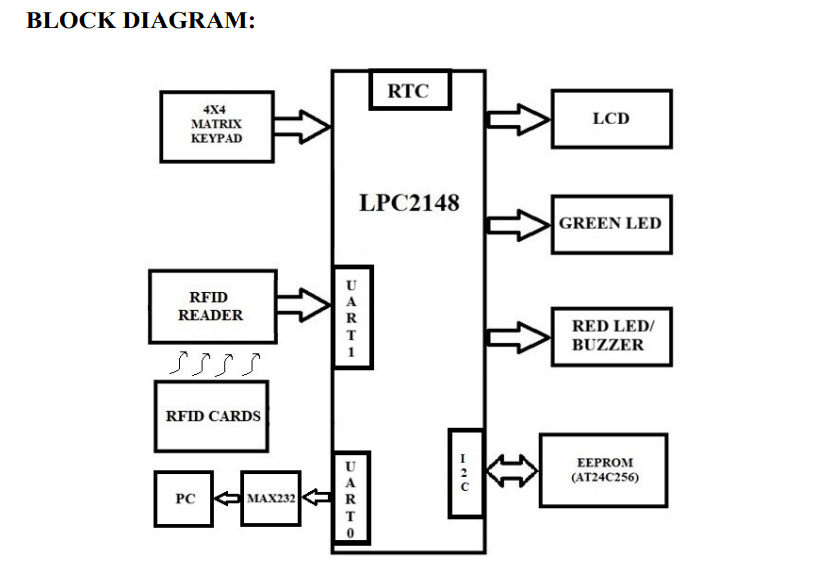
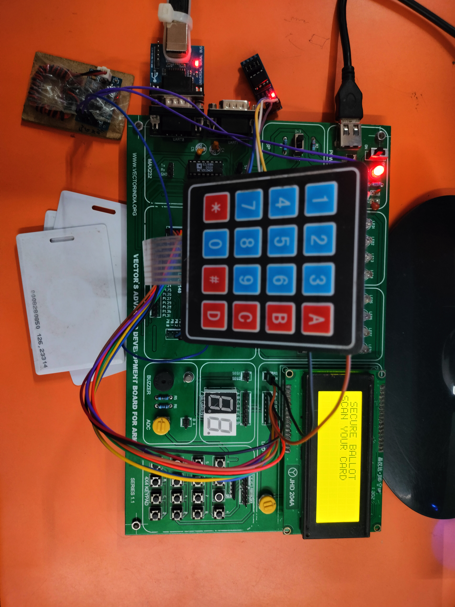
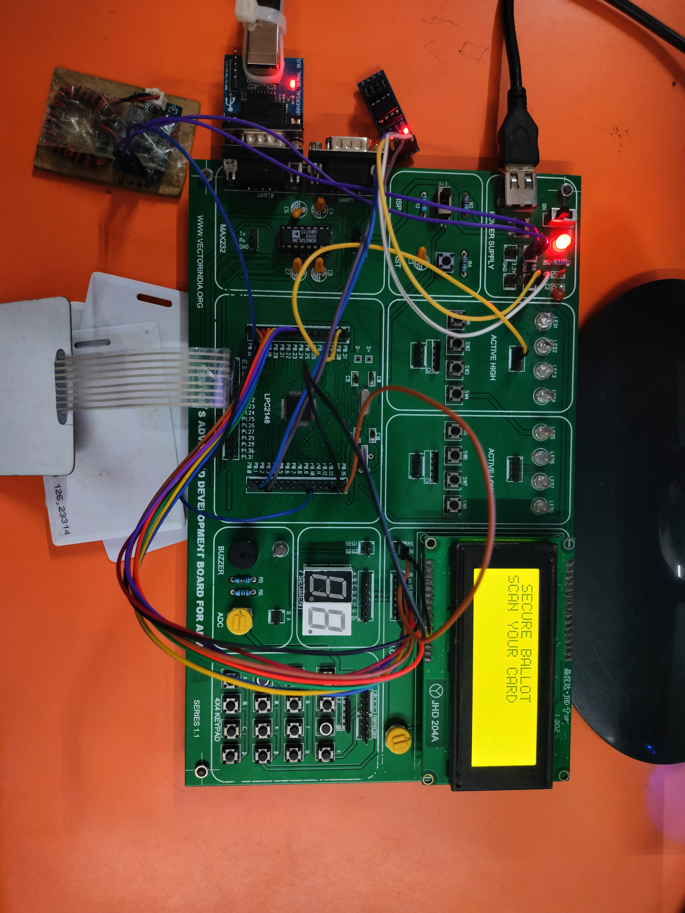

# 🗳️ SecureBallot — RFID-Based Secure Electronic Voting System

An embedded voting terminal built around the **NXP LPC2148 (ARM7TDMI-S)** microcontroller. Voters and an election officer are identified by **RFID cards**, votes are entered on a **4x4 keypad**, results are shown on a **20x4 character LCD**, all voting state is stored in an external **AT24C256 I2C EEPROM**, the on-chip **RTC** enforces the voting time window, and every significant action is streamed to a **PC over UART0** as a timestamped CSV audit log.

> **Educational project - not a certified election system.** This firmware was written as an academic/learning project. It is **not** production-ready and **must not** be used for real public elections without independent cryptographic and security review. See [Limitations & Future Improvements](#25-limitations-and-future-improvements).

---

## Table of Contents

1. [Project Overview](#1-project-title-and-overview)
2. [Project Objectives](#2-project-objectives)
3. [Features](#3-features)
4. [Hardware Components](#4-hardware-components)
5. [Software & Development Tools](#5-software-and-development-tools)
6. [Technologies & Communication Protocols](#6-technologies-and-communication-protocols)
7. [System Block Diagram](#7-system-block-diagram)
8. [Hardware Architecture & Component Descriptions](#8-hardware-architecture-and-component-descriptions)
9. [Software Module Descriptions](#9-software-module-descriptions)
10. [System Working Flow](#10-system-working-flow-step-by-step)
11. [RFID Card Communication & Authentication](#11-rfid-card-communication-and-authentication)
12. [UART0 and UART1 Roles](#12-uart0-and-uart1-roles)
13. [UART1 RFID Receive Interrupt](#13-uart1-rfid-receive-interrupt)
14. [I2C Communication & AT24C256 EEPROM](#14-i2c-communication--at24c256-eeprom-storage)
15. [RTC and Voting-Time Validation](#15-rtc-and-voting-time-validation)
16. [LCD and Keypad Operation](#16-lcd-and-keypad-operation)
17. [Voter Workflow](#17-voter-workflow)
18. [Officer Workflow](#18-officer-workflow)
19. [Vote Counting & Duplicate-Vote Prevention](#19-vote-counting--duplicate-vote-prevention)
20. [PC-Based Audit Logging](#20-pc-based-audit-logging)
21. [Repository Folder Structure](#21-repository-folder-structure)
22. [Development Environment & Build](#22-development-environment--build-instructions)
23. [Hardware Setup & Wiring](#23-hardware-setup--wiring)
24. [Testing & Validation](#24-testing--validation)
25. [Limitations & Future Improvements](#25-limitations-and-future-improvements)
26. [Learning Outcomes](#26-learning-outcomes)
27. [Author / Contributors](#27-author--contributors)
28. [License](#28-license)

---

## 1. Project Title and Overview

**SecureBallot** is a self-contained electronic voting machine (EVM) prototype. It replaces the traditional paper-ballot / ink-mark process with an RFID-authenticated, keypad-driven terminal that records votes electronically, prevents a voter from voting twice, restricts voting to an officer-defined time window, tallies results, and writes a full audit trail to a connected PC.

The system is centred on the **LPC2148**, a popular 32-bit ARM7 microcontroller widely used in engineering curricula. The design cleanly separates six concerns that are easy to confuse in a voting system - **authentication**, **voting-period validation**, **vote recording**, **duplicate-vote prevention**, **officer administration**, and **audit logging** - and each is handled by a dedicated software module (see [section 9](#9-software-module-descriptions)).

**At a glance:**

| Aspect | Detail |
|---|---|
| Main controller | NXP **LPC2148** (ARM7TDMI-S), 32-bit |
| CPU clock | 60 MHz (12 MHz crystal x 5 PLL) |
| Voter/officer ID | **RFID cards** read over UART1 (interrupt-driven) |
| Human input | **4x4 matrix keypad** |
| Human output | **20x4 character LCD** (HD44780) |
| Persistent storage | **AT24C256** 256-Kbit serial EEPROM over I2C |
| Time keeping | On-chip **LPC2148 RTC** |
| Audit logging | **UART0** to PC serial console (CSV lines) |
| Candidates | 4 parties (Batters, Bowlers, Keepers, Umpires) |
| Registered voters | 3 voters + 1 officer (as configured in firmware) |

---

## 2. Project Objectives

- **Authenticate each person by RFID card** before any voting action is allowed, distinguishing the election officer from the three voters.
- **Enforce a voting time window** using the RTC so that votes can only be cast between an officer-configured start and end time.
- **Provide a secure, guided voter interface** on the LCD and keypad for selecting a party and confirming a vote.
- **Prevent duplicate voting** by permanently recording, in EEPROM, that a voter has already cast a ballot.
- **Give the officer administrative control** to set the voting period, start/stop voting, view live results, reset the election, and set the RTC - all protected by an officer password.
- **Store all voting state in non-volatile memory** (EEPROM) so results and statuses survive a power cycle.
- **Produce a timestamped audit log** on a PC for transparency and later review.
- **Demonstrate practical embedded skills**: UART interrupts, I2C register-level programming, EEPROM memory mapping, RTC usage, LCD/keypad drivers, and a state-machine style main loop.

---

## 3. Features

- **RFID-based identification** - card IDs are captured automatically by a UART1 receive interrupt; no manual typing of IDs.
- **Role-based access** - the card reader maps a card to either *Officer* or one of three *Voters*.
- **Password protection (second factor)** - voters enter a 4-digit PIN before voting; officers enter a PIN before administrative actions.
- **Time-window enforcement** - voting is only accepted when the current RTC time falls inside the configured start/end window.
- **Duplicate-vote prevention** - once a voter votes, their status byte in EEPROM is set and further attempts are refused.
- **Live vote tally** - votes are counted per party in EEPROM and can be displayed on demand.
- **Result & winner display** - the officer view shows each party total and announces the leading party.
- **Election reset** - an officer can clear all counts, voter statuses, and the voting-enabled flag to start a fresh election.
- **Editable passwords** - voters can change their own PIN; the officer password is configurable.
- **RTC editing** - the officer can set date/time on the device from the keypad.
- **Non-volatile configuration** - a first-run initialization marker (`0xA5`) seeds default passwords and a wide-open default voting window (00:00-23:59) exactly once.
- **CSV audit logging** - authentication, card scans, blocked access, and voting events are logged to the PC over UART0.

---

## 4. Hardware Components

The following components are confirmed by the source code (`component_defines.h`, `rtc.c`, and the driver files):

| # | Component | Role in the project | Confirmed in source |
|---|-----------|---------------------|---------------------|
| 1 | **NXP LPC2148** ARM7 development board | Main microcontroller / controller | Yes (`rtc.c`: `CPU == LPC2148`) |
| 2 | **RFID reader module** (UART/RS232-TTL output) | Reads card IDs, sends frames to UART1 | Yes (`uart1int.c` ISR) |
| 3 | **RFID cards / tags** (125 kHz EM-type, 8-digit IDs) | Identify officer and voters | Yes (`authenticate.c`) |
| 4 | **20x4 character LCD** (HD44780 controller) | All menus, prompts, results | Yes (`lcd.c`, `component_defines.h`) |
| 5 | **4x4 matrix keypad** | Numeric/option input, PIN entry | Yes (`kpm.c`) |
| 6 | **AT24C256 serial EEPROM** (256 Kbit, I2C) | Stores passwords, statuses, counts, times | Yes (`i2c_eeprom.c`, memory map) |
| 7 | **LPC2148 on-chip RTC** | Date/time for voting-window checks & logs | Yes (`rtc.c`) |
| 8 | **USB-to-UART / serial interface** for PC | Receives CSV audit log over UART0 | Yes (`uart0.c`, `logger.c`) |
| 9 | **Buzzer** | Audio feedback | **Not found in source** - see note below |
| 10 | **LEDs** | Visual feedback | **Only commented-out** (see note below) |

**Notes on items 9 and 10:**
- The source contains only a **commented-out** green-LED toggle after a successful vote (`voter.c`, `CastVote`) referencing an undefined `GREEN_LED` pin. There is no active LED or buzzer driver, and no pin is defined for them. Any LED/buzzer on the physical board is therefore **not driven by the current firmware**, and their exact wiring is **not specified in the supplied files**.
- The **RFID reader model, cards, and the MAX232 vs. USB-to-UART choice** for the PC link are **not specified in the supplied files**. The code only shows a standard UART0 that a USB-to-serial adapter (or an RS-232 level shifter) can connect to.

---

## 5. Software and Development Tools

| Item | Detail | Source |
|------|--------|--------|
| Language | **C** (Embedded C) | All `.c` files |
| Target MCU | **NXP LPC2148** (ARM7TDMI-S) | `rtc.c`, `LPC21xx.h`/`lpc214x.h` includes |
| Toolchain / IDE | **Keil MDK (uVision)** - inferred from `LPC21xx.h`/`lpc214x.h` device headers and `__irq` keyword | Include lines |
| Device header files | `LPC21xx.h`, `lpc214x.h` (supplied by Keil, **not** in this repo) | Include lines |
| Standard library | `<string.h>` (for `strcmp`) | `authenticate.c` |
| PC terminal | Any serial terminal (e.g. PuTTY, Tera Term, Arduino Serial Monitor) at 9600 baud | `BAUD 9600` |

> **Build tooling not included:** There is **no Keil `.uvproj`/`.uvprojx` project file** in the supplied files, and no Makefile. You must create a Keil uVision project and add the source files (see [section 22](#22-development-environment--build-instructions)). The ARM device headers (`LPC21xx.h`, `lpc214x.h`) must be present in your Keil installation.

---

## 6. Technologies and Communication Protocols

| Technology / Protocol | Where it is used |
|-----------------------|------------------|
| **ARM7TDMI-S (LPC2148)** | Core CPU, register-level peripheral access |
| **UART ( asynchronous serial )** | Two independent UARTs: UART0 (PC log) and UART1 (RFID) |
| **UART interrupts (IRQ, VIC)** | UART1 receive-data interrupt drives RFID capture (`uart1int.c`) |
| **I2C (Inter-Integrated Circuit), 100 kHz** | Bit-banged via LPC2148 I2C peripheral to talk to the EEPROM (`i2c.c`) |
| **SPI / ADC / PWM** | **Not used** in this project |
| **RTC (Real-Time Clock)** | On-chip LPC2148 RTC, external clock source (`rtc.c`) |
| **EEPROM (AT24C256)** | Non-volatile storage over I2C |
| **HD44780 LCD protocol** | 8-bit parallel interface to the 20x4 LCD |
| **Matrix keypad scanning** | Row-drive / column-sense scanning algorithm |
| **CSV over serial** | Human- and machine-readable audit log format |

---

## 7. System Block Diagram



*Figure 1: SecureBallot system block diagram. The LPC2148 sits at the centre, connected to the RFID reader (UART1), the 20x4 LCD and 4x4 keypad, the AT24C256 EEPROM and RTC over I2C/on-chip, and the PC over UART0 for audit logging.*

If the image above does not render, open it directly at [`images/Block_Diag.png`](images/Block_Diag.png).

---

## 8. Hardware Architecture and Component Descriptions

### 8.1 LPC2148 Microcontroller (main controller)

The LPC2148 is the brain of the system. It is a 32-bit ARM7TDMI-S MCU with two UARTs, an I2C interface, an on-chip RTC, a Vectored Interrupt Controller (VIC), and multiple GPIO ports. In this project it is clocked at **60 MHz**, derived from a **12 MHz crystal multiplied by 5** by the internal PLL (`CCLK = FOSC * 5`, `PCLK = CCLK / 4 = 15 MHz`). All peripherals - UART, I2C, GPIO, RTC - are configured by writing directly to the LPC2148 registers.

### 8.2 RFID reader and RFID cards

An external RFID reader is wired to **UART1** (P0.8 = TXD1, P0.9 = RXD1). When a card is presented, the reader transmits a small frame over UART1 that the firmware captures in an interrupt. Each card carries an **8-digit ID**; the firmware compares that ID against a fixed list to decide whether the holder is the officer or a voter (see [section 11](#11-rfid-card-communication-and-authentication)).

### 8.3 20x4 Character LCD (HD44780)

A 4-row, 20-column alphanumeric LCD provides all user feedback. It is driven in **8-bit parallel mode** using 8 GPIO data lines (starting at pin 16 of Port 0) plus three control lines: **RS** (P0.13), **RW** (P0.15) and **EN** (P0.14). The HD44780 command set (clear, cursor position, display on/off, etc.) is defined in `component_defines.h`.

### 8.4 4x4 Matrix Keypad

The 16-key keypad is wired to **Port 1**. Four **row** lines (P1.16-P1.19) are configured as outputs and four **column** lines (P1.20-P1.23) as inputs. The driver energises one row at a time and senses which column is pulled low to identify the pressed key, mapping it through a lookup table to characters `0-9`, `A-D`, `*` and `#`.

### 8.5 AT24C256 Serial EEPROM (I2C)

The AT24C256 is a 256-Kbit (32 KB) non-volatile memory used as the project database. It stores the officer/voter PINs, each voter voting status, the four party vote counts, the voting time window, and an initialization marker. It is addressed over **I2C** at 7-bit slave address **0x50** (further addresses 0x51-0x57 are defined for chained devices but only 0x50 is used).

### 8.6 RTC (Real-Time Clock)

The LPC2148 has a built-in RTC that keeps seconds, minutes, hours, day-of-month, month, year and day-of-week. It is enabled in `rtc.c` using the **external clock source**. The RTC time is what the firmware compares against the voting window, and it also timestamps every audit-log line.

### 8.7 UART Interfaces

Two UARTs are used:

- **UART0** (P0.0 = TXD0, P0.1 = RXD0) -> connects to a PC serial console and carries the audit log.
- **UART1** (P0.8 = TXD1, P0.9 = RXD1) -> connects to the RFID reader.

Both run at **9600 baud**, 8 data bits, 1 stop bit, no parity.

### 8.8 PC logging interface

UART0 is a standard TTL-level serial port. To reach a PC it is normally connected through a **USB-to-UART bridge** or an RS-232 level shifter. The exact physical adapter is **not specified in the supplied files**; any device that presents the 9600-baud stream as a COM port will work for capturing the log.

---

## 9. Software Module Descriptions

Each file has a single, well-defined job. Descriptions below are based on the actual code.

### 9.1 `secure_ballot_system_main.c` - Program entry point & main loop

Contains `main()`. On start-up it initialises every peripheral (LCD, keypad, I2C, RTC, UART0, UART1), programs a **test RTC time**, and on the very first run (detected via the EEPROM init marker `0xA5`) seeds default PINs (officer `0000`, voters `1111`/`2222`/`3333`), a default 00:00-23:59 voting window, and zeroed counts/statuses. It then shows the welcome screen and enters an infinite loop that waits for the RFID `flag`, logs and authenticates each card, and dispatches to the officer or voter flow based on the returned role.

### 9.2 `authenticate.c` - Card-to-role mapping

Holds the four hard-coded card IDs and the `Authenticate()` function, which compares the received 8-character ID with each known ID using `strcmp` and returns a role constant: `OFFICER`, `VOTER1`, `VOTER2`, `VOTER3`, or `INVALID_CARD`.

### 9.3 `voter.c` - Voter-facing logic

Implements `CheckVotingStatus()` (voting-enabled flag **and** time-window check), the voter menu, `Voting()` (the guarded path to a vote), `PasswordCheck()`, `ShowPartyMenu()`, `CastVote()` (increments a party count and marks the voter as voted), `AlreadyVoted()`, and `EditPassword()`.

### 9.4 `officer.c` - Officer-facing administration

Implements `Get2Digit()` (a validated two-digit numeric entry used for time fields), `SetVotingTime()`, `OfficerPasswordCheck()`, `StartVoting()`, `StopVoting()`, `ViewResult()` (prints all four totals and the leader), `ResetVoting()`, and `RTC_Edit()` (sets date/time from the keypad).

### 9.5 `logger.c` - PC audit logging

Keeps a copy of the current card ID (`Logger_SetCardID`/`Logger_GetCardID`) and provides `LogEvent()`, which sends one CSV line over UART0 in the form:

`DD-MM-YYYY, HH:MM:SS, EVENT, CARD_ID, STATUS, DESCRIPTION`

### 9.6 `uart0.c` - UART0 driver (PC link)

Initialises UART0 (P0.0/P0.1, 9600 baud) and provides blocking transmit/receive helpers plus numeric/string printing helpers (`U0_Tx`, `U0_TxStr`, `U0_TxU32`, `U0_Rx`, etc.). Used by the logger.

### 9.7 `uart1int.c` - UART1 driver + RFID receive ISR

Initialises UART1 (P0.8/P0.9, 9600 baud) **and its receive interrupt** via the VIC. The `UART1_isr()` handler builds the card ID from the incoming frame. Also provides `U1_Tx*`/`U1_Rx*` helpers. This is where the RFID byte-stream is turned into `rfidBuf` and the `flag` (see [section 13](#13-uart1-rfid-receive-interrupt)).

### 9.8 `i2c.c` - Low-level I2C primitives

Register-level control of the LPC2148 I2C peripheral: `init_i2c()` (sets SCL/SDA pin functions and 100 kHz timing), `i2c_start()`, `i2c_restart()`, `i2c_stop()`, `i2c_write()`, `i2c_mack()`, `i2c_nack()`.

### 9.9 `i2c_eeprom.c` - EEPROM high-level access

Builds on the I2C primitives to provide `i2c_eeprom_bytewrite()`, `i2c_eeprom_randomread()`, `i2c_eeprom_pagewrite()` and `i2c_eeprom_seqread()`. Addresses are 16-bit (two bytes) to match the AT24C256.

### 9.10 `rtc.c` - Real-Time Clock

`RTC_Init()` enables the on-chip RTC (external clock source). Setter/getter functions read/write the LPC2148 RTC registers (HOUR/MIN/SEC/DOM/MONTH/YEAR/DOW) and display helpers format them for the LCD.

### 9.11 `lcd.c` - LCD driver

Initialises the HD44780 in 8-bit, 2-line mode and provides `CmdLCD`, `CharLCD`, `StrLCD`, `U32LCD` and additional formatting helpers (hex/octal/float, CGRAM) plus a `BuildCGRAM()` custom-character utility.

### 9.12 `kpm.c` - Keypad driver

`Init_KPM()` configures the keypad port; `KeyScan()` blocks until a key is pressed then released and returns the decoded character using the 4x4 lookup table. Also provides `ReadNum()` and `ReadPassword()` helper entry routines.

### 9.13 `delay.c` - Software delays

Provides `dly_us()`, `dly_ms()` and `dly_s()` using busy-wait loops calibrated for the 60 MHz clock. Used throughout for LCD timing and user-visible pauses.

### 9.14 `component_defines.h` - Pin, protocol & memory-map definitions

Single source of truth for: LCD command/pin macros, keypad row/column pins, clock/UART/I2C configuration, EEPROM slave addresses, the full **EEPROM memory map**, and the authentication role constants.

### 9.15 `functiondeclaration.h` - Types & prototypes

Defines the project data types (`u8`, `s8`, `u16`, ... ) and declares every function used across the modules, plus the shared RFID variables (`rfidBuf`, `ind`, `flag`).

---

## 10. System Working Flow, Step by Step

1. **Power-on initialisation** - `main()` initialises LCD, keypad, I2C, RTC, UART0 and UART1, then programs a starting RTC time.
2. **First-run setup (once only)** - If the EEPROM init marker is not `0xA5`, the firmware writes default PINs, a 00:00-23:59 voting window, zeroed vote counts and voter statuses, then stores the marker.
3. **System-start log** - A `SYSTEM_START` line is sent to the PC.
4. **Welcome screen** - The LCD shows `SECURE BALLOT` / `SCAN YOUR CARD`.
5. **Wait for a card** - The main loop idles until the UART1 interrupt sets `flag = 1` after receiving a complete card frame.
6. **Log and authenticate** - The card ID is logged (`CARD_SCAN`) and passed to `Authenticate()`, which returns a role.
7. **Branch by role** - Officer cards open the officer menu; voter cards open that voter menu; unknown cards show `INVALID CARD`.
8. **Voter path** - Menu then Voting then (voting open? already voted? PIN correct?) then pick a party then vote stored, voter marked as voted.
9. **Officer path** - Set time / start / stop / view result / reset / edit RTC / exit, each admin action guarded by the officer PIN.
10. **Return to scan screen** - After a session the loop returns to step 4.

---

## 11. RFID Card Communication and Authentication

### 11.1 The received frame (verified from `uart1int.c`)

The RFID reader sends a delimited frame on UART1. The interrupt handler in `uart1int.c` confirms the following structure:

- **STX** = `0x02` (start of text) sets `flag = 1`.
- The next bytes are the **8 ASCII card-ID characters**, stored one-by-one into `rfidBuf`.
- **ETX** = `0x03` (end of text) clears `flag` and resets the index.

**Example frame** for a card whose ID is `12548413`:

```
STX    1   2   5   4   8   4   1   3    ETX
0x02 -------------------------------------> 0x03
```

In bytes the reader transmits: `0x02`, then the ASCII codes for `1 2 5 4 8 4 1 3`, then `0x03`. The firmware keeps only the 8 middle characters as the card ID string.

### 11.2 Card-to-role mapping

`authenticate.c` compares the assembled 8-character ID against four fixed IDs with `strcmp`:

- `OFFICER` (value 1) -> ID `12548413`
- `VOTER1`  (value 2) -> ID `12543380`
- `VOTER2`  (value 3) -> ID `00354731`
- `VOTER3`  (value 4) -> ID `00352530`
- `INVALID_CARD` (value 0) -> no match

> **Security note:** These IDs and the PINs are stored and compared in **plain text**. This is acceptable for a teaching prototype but is a significant limitation for any real deployment (see [section 25](#25-limitations-and-future-improvements)).

---


## 12. UART0 and UART1 Roles

The LPC2148 has two independent UARTs, and this project uses them for two clearly separated purposes:

| Aspect | UART0 | UART1 |
|--------|-------|-------|
| Pins | P0.0 (TXD0), P0.1 (RXD0) | P0.8 (TXD1), P0.9 (RXD1) |
| Connected to | PC (audit log) | RFID reader |
| Direction | Mostly transmit (logging) | Receive (card frames) |
| Baud rate | 9600 | 9600 |
| Interrupt | Not used (blocking) | Receive interrupt used |
| Driver file | `uart0.c` | `uart1int.c` |
| Typical data | CSV audit lines | `0x02` + 8 chars + `0x03` |

---

## 13. UART1 RFID Receive Interrupt

**Yes - the code confirms** that RFID input is handled by a **UART1 receive interrupt**, not by polling.

**How it works:**

1. `UART1_Init()` enables the UART1 **Receive Data Available (RDA)** interrupt (`U1IER = 0x01`) and registers `UART1_isr` on **VIC channel 7** (slot 0), selecting it as an IRQ (not FIQ).
2. Each time a byte arrives, `UART1_isr()` runs:
   - It checks the interrupt ID (`(U1IIR & 0x0E) == 0x04` corresponds to RDA) and reads the byte from `U1RBR`.
   - If the byte is **STX (`0x02`)**, it sets `flag = 1`.
   - If the byte is **ETX (`0x03`)**, it sets `flag = 0` and resets the buffer index.
   - Otherwise it appends the byte to `rfidBuf`.
3. It acknowledges the interrupt by writing `VICVectAddr = 0`.
4. Meanwhile, `main()` polls the `flag`. When a full card has been captured, it copies `rfidBuf`, logs it, and authenticates it.

**Why an interrupt?** A card can be presented at any moment. Using an interrupt means the CPU does not busy-wait on UART1; the handler captures bytes as they arrive, and the main loop stays responsive to the keypad and LCD.

---


## 14. I2C Communication and AT24C256 EEPROM Storage

### 14.1 The I2C bus

The firmware talks to the EEPROM using the LPC2148's **I2C** peripheral at **100 kHz** (`I2C_SPEED 100000`). `i2c.c` drives the bus at the register level with the classic primitives: `i2c_start`, `i2c_restart`, `i2c_write`, `i2c_mack`/`i2c_nack` (master acknowledge / not-acknowledge) and `i2c_stop`. The SCL/SDA pin functions and the timing divisor (`LOADVAL`) are computed from the peripheral clock.

### 14.2 The EEPROM access layer

`i2c_eeprom.c` turns those primitives into easy calls:

- `i2c_eeprom_bytewrite(slaveAddr, memAddr, data)` - writes one byte (start, slave+write, 16-bit address, data, stop, then a short write-cycle delay).
- `i2c_eeprom_randomread(slaveAddr, memAddr)` - reads one byte from any address (dummy-write the address, restart, slave+read, NACK, stop).
- `i2c_eeprom_pagewrite(...)` and `i2c_eeprom_seqread(...)` - block transfers.

The 7-bit slave address is shifted left by one in software (`slaveAddr << 1`) to form the 8-bit address+R/W byte, and the low bit selects read (`| 1`) or write.

### 14.3 The AT24C256 memory map (from `component_defines.h`)

The project uses a fixed memory map inside the AT24C256 at slave address **0x50**:

| Address | Constant | Stores |
|---------|----------|--------|
| `0x0000` | `EEPROM_VOTING_ENABLE` | 1 = voting open, 0 = closed |
| `0x0001` | `EEPROM_START_HOUR` | Voting start hour |
| `0x0002` | `EEPROM_START_MIN` | Voting start minute |
| `0x0003` | `EEPROM_END_HOUR` | Voting end hour |
| `0x0004` | `EEPROM_END_MIN` | Voting end minute |
| `0x0010` | `EEPROM_VOTER1_ID` | Reserved area for Voter 1 ID |
| `0x0020` | `EEPROM_VOTER2_ID` | Reserved area for Voter 2 ID |
| `0x0030` | `EEPROM_VOTER3_ID` | Reserved area for Voter 3 ID |
| `0x0040` | `EEPROM_VOTER1_PASS` | Voter 1 PIN (4 bytes) |
| `0x0044` | `EEPROM_VOTER2_PASS` | Voter 2 PIN (4 bytes) |
| `0x0048` | `EEPROM_VOTER3_PASS` | Voter 3 PIN (4 bytes) |
| `0x0050` | `EEPROM_VOTER1_STATUS` | 1 if Voter 1 has voted |
| `0x0051` | `EEPROM_VOTER2_STATUS` | 1 if Voter 2 has voted |
| `0x0052` | `EEPROM_VOTER3_STATUS` | 1 if Voter 3 has voted |
| `0x0060` | `EEPROM_PARTY1_COUNT` | Votes for party 1 (Batters) |
| `0x0061` | `EEPROM_PARTY2_COUNT` | Votes for party 2 (Bowlers) |
| `0x0062` | `EEPROM_PARTY3_COUNT` | Votes for party 3 (Keepers) |
| `0x0063` | `EEPROM_PARTY4_COUNT` | Votes for party 4 (Umpires) |
| `0x0070` | `EEPROM_OFFICER_PASS` | Officer PIN (4 bytes) |
| `0x0080` | `EEPROM_INIT_FLAG` | First-run marker (`0xA5` when initialised) |

> **Note:** The three `*_ID` regions are **reserved** in the map but the current firmware keeps the card IDs hard-coded in `authenticate.c` instead of reading them from EEPROM. This is an inconsistency you may want to resolve in a future revision.

---

## 15. RTC and Voting-Time Validation

### 15.1 The RTC

`rtc.c` enables the LPC2148's on-chip RTC. The setter/getter functions simply read and write the MCU's RTC registers (`HOUR`, `MIN`, `SEC`, `DOM`, `MONTH`, `YEAR`, `DOW`). At start-up `main()` programs a fixed time, and the officer can later change it through `RTC_Edit()`.

### 15.2 The voting-window check

Voting is allowed only if **both** of these are true (see `CheckVotingStatus()` in `voter.c`):

1. The **voting-enabled flag** in EEPROM is `1` (the officer has started voting).
2. The **current RTC time** lies inside the configured window:
   - `now >= start` (not before the start hour/minute), **and**
   - `now <= end` (not after the end hour/minute).

If either check fails, the voter sees `VOTING NOT OPEN / ACCESS DENIED` and a `VOTING ACCESS BLOCKED` entry is logged. This keeps **voting-period validation** separate from **authentication**: a valid voter with a correct PIN still cannot vote outside the allowed window.

---

## 16. LCD and Keypad Operation

### 16.1 LCD (`lcd.c`)

The 20x4 HD44780 LCD is initialised in **8-bit, 2-line** mode with the display on and the cursor off. Higher-level helpers hide the low-level signalling:

- `CmdLCD(cmd)` - send a command (clear screen, move cursor, etc.).
- `CharLCD(ch)` - print one character.
- `StrLCD(str)` - print a string.
- `U32LCD(num)` - print an unsigned number (used for vote counts and the year).

Cursor row addresses used in the code are `0x80` (line 1), `0xC0` (line 2), `0x94` (line 3) and `0xD4` (line 4). **Note:** the macros `GOTO_LINE3_POS0` (`0x90`) and `GOTO_LINE4_POS0` (`0xD0`) in `component_defines.h` differ from the `0x94`/`0xD4` values the screens actually use; the literal values in the menu code are what take effect.

### 16.2 Keypad (`kpm.c`)

`KeyScan()` blocks until a key is pressed and released, then returns the decoded character using this 4x4 lookup table:

| | Col 0 | Col 1 | Col 2 | Col 3 |
|---|-------|-------|-------|-------|
| **Row 0** | `1` | `2` | `3` | `A` |
| **Row 1** | `4` | `5` | `6` | `B` |
| **Row 2** | `7` | `8` | `9` | `C` |
| **Row 3** | `*` | `0` | `#` | `D` |

Conventions used throughout the UI: `#` = **ENTER/confirm**, `C` = **backspace**, digits select menu options.

---


## 17. Voter Workflow

1. **Scan card** - Present a voter RFID card. The ISR captures the ID and `main()` authenticates it.
2. **Voter menu** - The LCD shows the voter number and three options: `1. VOTING`, `2. EDIT PASSWORD`, `3. EXIT`.
3. **Choose VOTING** - `Voting()` runs three guards in order:
   1. **Is voting open?** (`CheckVotingStatus()` - flag + time window). If not, access is blocked and logged.
   2. **Already voted?** (`AlreadyVoted()` - reads the voter's status byte). If yes, `ALREADY VOTED / ACCESS DENIED`.
   3. **Correct PIN?** (`PasswordCheck()` - 4 digits). If wrong, `WRONG PASSWORD / ACCESS DENIED`.
4. **Select a party** - `ShowPartyMenu()` lists the four parties; the voter presses `1`-`4`.
5. **Vote recorded** - `CastVote()` increments the chosen party's count in EEPROM **and** sets that voter's status byte to `1`, then shows `VOTE CAST SUCCESSFULLY`.
6. **Return** - The voter can exit to the main scan screen.

**Edit Password** (option 2) lets a voter change their own 4-digit PIN after entering the current one. The new PIN is written to EEPROM.

---

## 18. Officer Workflow

The officer card opens a password-protected admin menu:

| Key | Function | What it does |
|-----|----------|--------------|
| `1` | **SET TIME** | Enter start & end hour/minute for the voting window (validated end > start) |
| `2` | **START** | Set voting-enabled flag = 1 (opens voting) |
| `3` | **STOP** | Set voting-enabled flag = 0 (closes voting) |
| `4` | **RESULT** | Show all four party totals and announce the leader |
| `5` | **RESET** | Clear all counts, voter statuses and the voting flag (fresh election) |
| `6` | **RTC** | Set date/time/day on the device |
| `7` | **EXIT** | Return to the scan screen |

Every administrative action first calls `OfficerPasswordCheck()`. On success the officer proceeds; on failure the LCD shows `INVALID PASSWORD`. **Start**/**Stop** only flip the enabled flag - the actual "can this person vote right now?" decision is still made by the time-window check in `voter.c`.

---

## 19. Vote Counting and Duplicate-Vote Prevention

### 19.1 Vote counting

Each of the four parties has a single byte in EEPROM (`0x0060`-`0x0063`). When a vote is cast, `CastVote()` does a **read-modify-write**: it reads the current count, adds one, and writes it back. `ViewResult()` reads all four and displays them, then scans the array to find and announce the party with the highest count.

> **Scalability note:** Because each count is a single byte, a party can hold at most **255 votes**. This is fine for a demo but must change for any real electorate.

### 19.2 Duplicate-vote prevention

Before a vote is accepted, `AlreadyVoted()` reads the voter's dedicated **status byte** (`0x0050`-`0x0052`). It is `0` for a first-time voter and `1` after they vote. Since `CastVote()` sets it to `1` immediately after recording the vote, a second attempt hits the `ALREADY VOTED` guard and is refused. This is the mechanism that enforces **one person, one vote**.

> **Honest caveat:** Because the status lives in EEPROM keyed to a fixed voter slot (not cryptographically bound to the card), a determined user with hardware access could reset it. The prevention is logical, not cryptographic.

---

## 20. PC-Based Audit Logging

`logger.c` streams human- and machine-readable events to the PC over **UART0**. Every call to `LogEvent(event, cardID, status, description)` prints one CSV line:

```
DD-MM-YYYY, HH:MM:SS, EVENT, CARD_ID, STATUS, DESCRIPTION
```

The date/time prefix comes from the RTC (`SendDateTime()`), so each line is timestamped. Events logged in the current firmware include:

| Event | Meaning |
|-------|---------|
| `SYSTEM_START` | Firmware boot / initialisation complete |
| `CARD_SCAN` | An RFID card was detected (ID captured) |
| `AUTHENTICATION` | Result of matching the card to a role (SUCCESS/FAILED) |
| `OFFICER_LOGIN` | Officer card accepted |
| `VOTING ACCESS BLOCKED` | A voter tried to vote while voting was closed/out of window |

**How to capture it:** open a serial terminal on the PC, select the UART0 COM port, and set it to **9600 baud**, 8 data bits, 1 stop bit, no parity. The lines can be saved to a `.csv` file and opened in a spreadsheet for review.

> The physical connection to the PC (USB-to-UART bridge or RS-232 shifter) is **not specified in the supplied files**.

---


## 21. Repository Folder Structure

```
SecureBallot/
├── README.md                         # This file
├── LICENSE                           # License placeholder (see section 28)
├── .gitignore                        # C / Keil uVision ignores
├── src/                              # All C source files
│   ├── secure_ballot_system_main.c   #   main() + main loop
│   ├── authenticate.c                #   RFID ID -> role mapping
│   ├── voter.c                       #   voter menu, voting, duplicate check
│   ├── officer.c                     #   officer admin menu
│   ├── logger.c                      #   CSV audit logging (UART0)
│   ├── uart0.c                       #   UART0 driver (PC link)
│   ├── uart1int.c                    #   UART1 driver + RFID receive ISR
│   ├── i2c.c                         #   low-level I2C primitives
│   ├── i2c_eeprom.c                  #   EEPROM read/write helpers
│   ├── rtc.c                         #   on-chip RTC driver
│   ├── lcd.c                         #   20x4 LCD (HD44780) driver
│   ├── kpm.c                         #   4x4 keypad driver
│   └── delay.c                       #   software delay routines
├── include/                          # Header files
│   ├── component_defines.h           #   pins, protocols, EEPROM map, roles
│   └── functiondeclaration.h         #   data types + function prototypes
├── images/                           # Diagrams and photos
│   ├── Block_Diag.png                #   system block diagram
│   ├── IMG20261005120237.jpg.jpeg    #   implementation photo 1
│   └── IMG20261005120302.jpg.jpeg    #   implementation photo 2
└── docs/
    └── PROJECT_DOCUMENTATION.md      # Detailed technical documentation
```

> The original files were named with spaces and suffixes such as `i2c (1).c`, `kpm (3).c`, `lcd (4).c` and `rtc (1).c`. They were renamed to clean names (`i2c.c`, `kpm.c`, `lcd.c`, `rtc.c`, `i2c_eeprom.c`) to keep the build system happy. **No `#include` referenced these `.c` files by name**, so the rename does not break any dependency. The unmodified originals are preserved in the first Git commit.

---

## 22. Development Environment and Build Instructions

### 22.1 What you need

- **Keil MDK (uVision 4/5)** with support for the **NXP LPC214x** family (provides `LPC21xx.h` / `lpc214x.h`).
- An **LPC2148** development board and a suitable programmer/debugger.
- The physical peripherals described in [section 4](#4-hardware-components).

### 22.2 Creating the project (there is no `.uvproj` in this repo)

1. In Keil uVision: **Project -> New uVision Project**, pick a folder, and select the device **NXP LPC2148**.
2. Add all `.c` files from `src/` to the project (Target -> right panel -> Add Group, then add files).
3. **Set the include path**: **Options for Target -> C/C++ -> Include Paths** and add the `include/` directory so that `#include "component_defines.h"` and `#include "functiondeclaration.h"` resolve.
4. Build (**Project -> Build target**) and download to the board.

> **Build status: not verified.** No compiler/toolchain for LPC2148 is available in this environment, so the firmware has **not** been compiled here. The code targets the Keil/ARM toolchain indicated by the `LPC21xx.h` / `__irq` usage. Please build in Keil and report any warnings/errors.

---


## 23. Hardware Setup and Wiring

Pin assignments below are **read directly from `component_defines.h` and the driver files**. Anything not present in the source is marked as not specified.

| Peripheral | LPC2148 pin(s) | Notes |
|------------|----------------|-------|
| LCD data D0-D7 | P0.16 - P0.23 | `LCD_DATA = 16`, 8-bit mode |
| LCD RS | P0.13 | Register select |
| LCD RW | P0.15 | Read/Write (driven low = write) |
| LCD EN | P0.14 | Enable |
| Keypad rows | P1.16 - P1.19 | Outputs (`ROW0..ROW3`) |
| Keypad columns | P1.20 - P1.23 | Inputs (`COL0..COL3`) |
| UART0 TXD0 / RXD0 | P0.0 / P0.1 | To PC (audit log) |
| UART1 TXD1 / RXD1 | P0.8 / P0.9 | To RFID reader |
| I2C SCL / SDA | pin-function select | To AT24C256 |
| RTC | on-chip | External clock source enabled |

**Power, ground, pull-ups, crystal and level-shifter wiring are not specified in the supplied files.** The I2C lines require the usual pull-up resistors on real hardware, but their values are not given here because they are not in the source. The RFID reader's model and connector, and the exact USB-to-UART/RS-232 adapter for the PC link, are also **not specified**.

---

## 24. Testing and Validation

> **Important:** The steps below describe **how to test** the system. They are **not** a record of tests already performed - no hardware was available in this environment, so no runtime testing was carried out here.

Recommended validation procedure:

1. **Build** the project in Keil (see [section 22](#22-development-environment--build-instructions)) and confirm it compiles and links without errors.
2. **Power-on** - confirm the LCD shows the `SECURE BALLOT / SCAN YOUR CARD` welcome screen and a `SYSTEM_START` line appears on the PC terminal.
3. **First-run init** - on a blank EEPROM, confirm defaults are written (officer `0000`, voters `1111`/`2222`/`3333`, window 00:00-23:59).
4. **Officer flow** - scan the officer card, enter `0000`, set a voting window, start voting, and confirm the enabled flag changes (a voter should now be able to vote).
5. **Voter flow** - scan a voter card, enter the correct PIN, choose a party, and confirm `VOTE CAST SUCCESSFULLY` and that the party count increments in `RESULT`.
6. **Duplicate vote** - attempt to vote again with the same voter and confirm `ALREADY VOTED / ACCESS DENIED`.
7. **Time window** - set a window that excludes the current RTC time and confirm `VOTING NOT OPEN`.
8. **Invalid card** - scan an unregistered card and confirm `INVALID CARD`.
9. **Wrong PIN** - enter an incorrect PIN and confirm `WRONG PASSWORD / ACCESS DENIED`.
10. **Reset** - as officer, reset the election and confirm all counts/statuses return to zero.
11. **Audit log** - verify the PC captured the corresponding timestamped CSV lines for each of the above.

---


## 25. Limitations and Future Improvements

### Current limitations

- **Not a certified election system.** No cryptographic signing, no ballot secrecy, no tamper-proofing. Must not be used for real public elections.
- **Plain-text secrets.** Card IDs, officer PIN and voter PINs are stored and compared as plain text in EEPROM / source. No hashing or encryption.
- **Logical-only duplicate prevention.** The "already voted" flag is a plain EEPROM byte that a user with hardware access could clear.
- **Single-byte vote counts** cap each party at 255 votes.
- **Fixed voter/officer set.** Only 3 voters and 1 officer are supported; card IDs are hard-coded, not managed through the UI or read from the reserved EEPROM ID regions.
- **No persistent card-ID database in use.** The `*_ID` EEPROM regions are reserved but unused.
- **Blocking UI.** Keypad scans and UART logging are blocking; the device cannot do other work while waiting for input.
- **No active LED/buzzer feedback** in the compiled code (only commented-out placeholders).
- **Busy-wait delays** in `delay.c` tie up the CPU and are only approximate.

### Future improvements

- Hash/salt PINs and use challenge-response or signed RFID tags instead of fixed IDs.
- Bind the "voted" flag cryptographically to a card so it cannot be forged or reset.
- Use multi-byte counters and support a larger, dynamically managed voter list.
- Add real LEDs/buzzer feedback for accessibility.
- Make the log tamper-evident (e.g., a running hash chain) and store it on-board as a backup.
- Add a real-time display of the current RTC clock on the idle screen.
- Port to a non-blocking, state-machine or RTOS-based design.

---

## 26. Learning Outcomes

Working through this project teaches:

- **ARM7 (LPC2148) register-level programming** - configuring GPIO, UART, I2C and the RTC directly.
- **Interrupt handling** - writing a UART receive ISR and wiring it through the Vectored Interrupt Controller.
- **I2C and EEPROM** - bit-level I2C primitives and mapping a real database into an AT24C256 memory map.
- **Peripheral driver design** - clean separation of LCD, keypad, UART, I2C, EEPROM and RTC modules.
- **State-machine style application logic** - roles, menus, guarded voting, and administration.
- **Systems thinking** - separating authentication, authorization/time-window, recording, duplicate prevention, administration and auditing.
- **Embedded C practices** - shared headers, `volatile` for ISR-shared data, and modular builds.

---

## 27. Author / Contributors

- **Author:** Sai Rithwik
- **Email:** sairithwik502@gmail.com
- **Role:** Designer and developer of the SecureBallot firmware.

> Replace the placeholders above with your preferred name, GitHub profile and contact details before publishing, and add any collaborators/mentors here.

---

## 28. License

This project is released under the **MIT License** — see the [`LICENSE`](LICENSE) file for the full text.

```
MIT License

Copyright (c) 2026 Sai Rithwik
```

In short: you are free to use, copy, modify, merge, publish, distribute, sublicense, and/or sell copies of this project, as long as you include the original copyright notice and the license text. The software is provided "as is", without warranty of any kind.

**This project is provided for educational purposes only and carries no warranty. It is not suitable for use in real elections without independent security review and certification.**

---

## Project Hardware / Implementation Photos

Below are photographs of the SecureBallot hardware implementation.

<p align="center">
  <br>
  <em>Figure 2: SecureBallot hardware implementation (view 1).</em>
</p>

<p align="center">
  <br>
  <em>Figure 3: SecureBallot hardware implementation (view 2).</em>
</p>

---

*Thank you for reading! If you build or improve on SecureBallot, contributions and feedback are welcome.*

